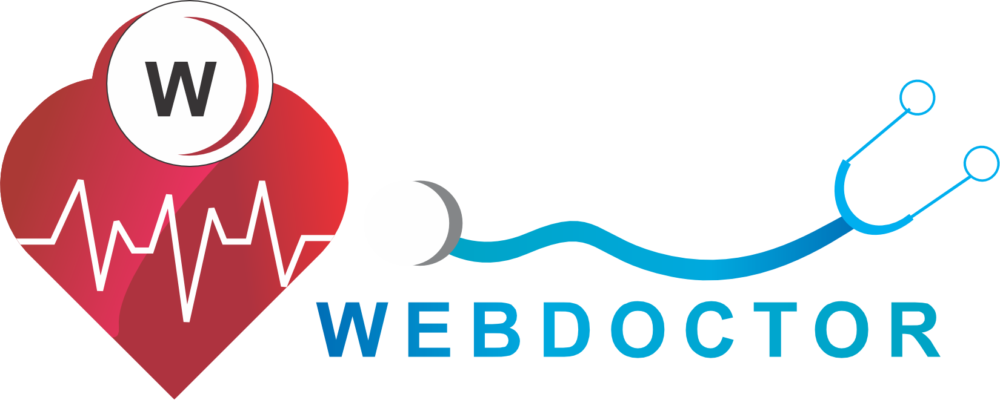
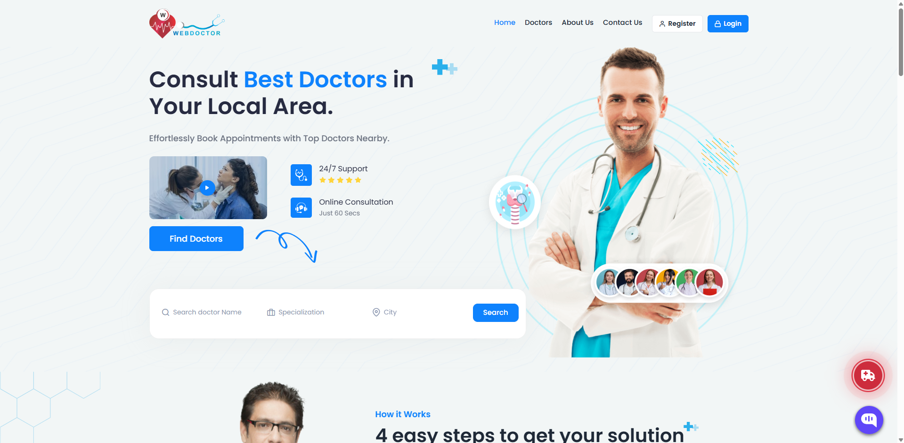
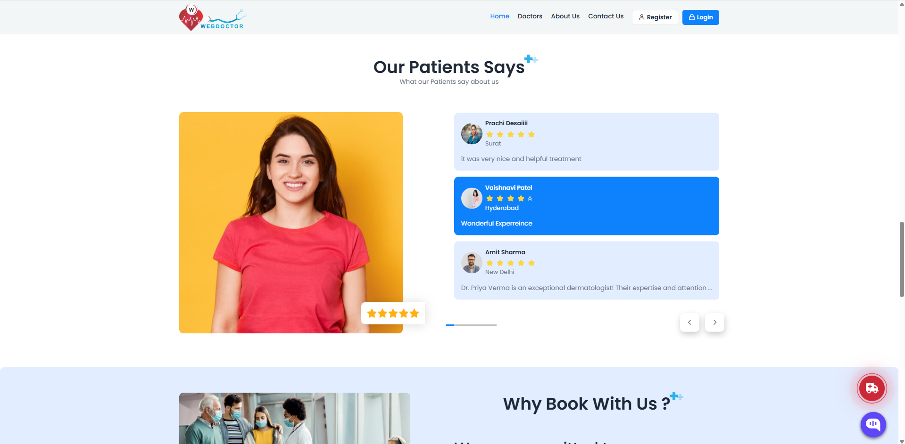
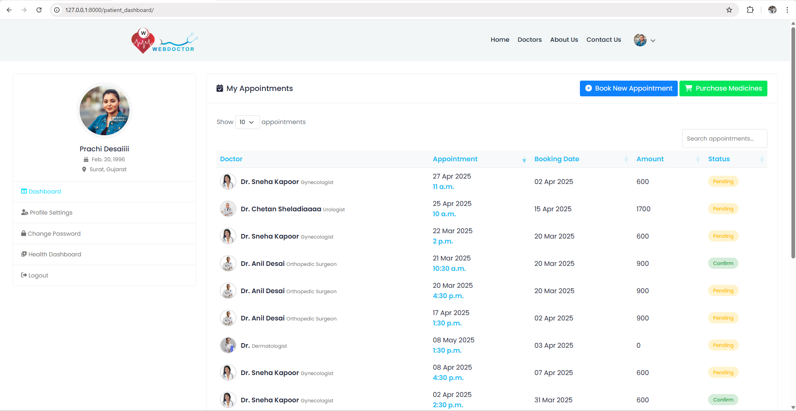
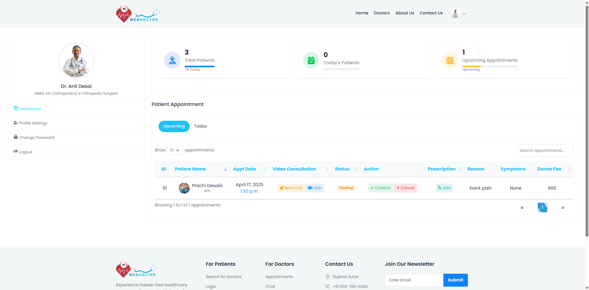

# 🩺 **WebDoctor – The Future of Healthcare, One Click Away**



---

## 📚 **Table of Contents**

- 📖 Introduction 
- ✨ Features
- 🖼️ Screenshots
- 🛠️ Installation
- 🚀 Usage
- 🤝 Contributing
- 📄 License

---

## 📖 Introduction

**WebDoctor** is a comprehensive web-based application designed to streamline healthcare facilities and enhance patient management. This project aims to provide a centralized platform that allows doctors, patients, and clinic administrators to efficiently manage medical records, appointments, and communication.

The primary objective of the **Patient Management System** is to:
- Improve the patient experience  
- Optimize healthcare provider efficiency  
- Maintain accurate and secure medical records  

By leveraging technology, WebDoctor simplifies the management of healthcare facilities and enhances the overall quality of care provided.

---

## ✨ Features

- **💼 Doctor Dashboard:** Manage appointments, view patient records, and update profiles in a clean interface.  
- **👩‍⚕️ Patient Dashboard:** Schedule appointments, access medical history, and communicate with doctors.  
- **📅 Admin Dashboard:** Add/remove doctors, monitor appointments, and manage clinic data with ease.  
- **⏰ Appointment Scheduling:** View doctor availability and book appointments effortlessly.  
- **📃 Electronic Health Records:** Securely store and retrieve complete medical histories.  
- **📢 Messaging System:** In-built doctor-patient chat for easy communication.  
- **🔍 Search and Filters:** Smart filters to help find the best healthcare provider quickly.  
- **📊 Data Analytics:** Access clinic insights and performance reports for smarter decisions.  
- **💻 Responsive Design:** Accessible on desktop, tablet, and mobile with full functionality.  

---

## Screenshots

### Home Page






---

## 🛠️ Installation

1. 📥 Clone the repository:
   ```bash
   git clone https://github.com/NiravWeb/WebDoctor-The-Future-of-Healthcare-One-Click-Away.git
   
2. 📦 Install the required dependencies: 
   ```bash
   pip install -r requirements.txt
   ```
---

## 🚀 Usage
1. ▶️ Run the application: `python manage.py runserver`
2. 🌐 Open your browser and go to: `http://127.0.0.1:8000/`
3. 🔗 Try the live demo: [https://pranikmedicalservices.pythonanywhere.com/](https://pranikmedicalservices.pythonanywhere.com/)

---

## 🤝 Contributing

We welcome contributions from the community to help improve **WebDoctor**! Whether it's fixing a bug, adding a new feature, or improving documentation, we appreciate your efforts.

### How to Contribute:
1. **Fork the repository**:  
   Click on the **fork** button in the top-right corner of this page to create a copy of the repository under your own GitHub account.

2. **Clone your forked repository**:  
   Clone your fork to your local machine using the following command:
   ```bash
   git clone https://github.com/NiravWeb/WebDoctor-The-Future-of-Healthcare-One-Click-Away.git
   
3. **Create a new branch:**:
   ```bash
   git checkout -b your-feature-branch
   
---

## License
This project is currently not licensed. All rights reserved.

---

## 💡 Feedback and Suggestions

We highly value your feedback and suggestions to help us improve **WebDoctor**! Whether it's a new feature idea, a bug report, or a suggestion for UI improvement, your input helps us enhance the platform for everyone.

### How to Provide Feedback:
- **Feature Requests:** Let us know if there's a feature you would like to see implemented.  
- **Bug Reports:** If you encounter any issues or bugs, please report them so we can fix them quickly.  
- **UI/UX Suggestions:** Share your thoughts on how we can improve the user experience, design, or accessibility.

Feel free to open an issue or contact us directly with your suggestions. Your contribution is important to us!

---

### Check out the Patient Management System:
Explore and use the **WebDoctor** platform at [WebDoctor Live](https://pranikmedicalservices.pythonanywhere.com/).

Thank you for your time and support in making **WebDoctor** a better tool for everyone. We appreciate your contribution! 🙏💙

